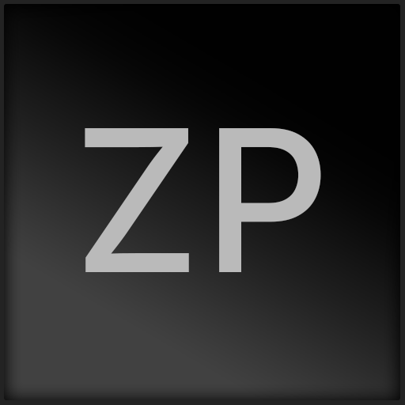

<h1 align="center">ZPlayer</h1>

For when you want your library to feel as good as it sounds.

  <a href="https://github.com/Zetph/ZPlayer-releases/releases/latest"><b>Download for Windows</b></a>

---

## What it does

- **Bit-perfect sound:** WASAPI exclusive and ASIO, gapless playback, and crossfade
- **Hi-res formats:** FLAC, ALAC, WAV, AIFF, and DSD, plus passthrough of Dolby and DTS to your receiver or soundbar
- **Your music, wherever it lives:** Local folders, SMB shares, WebDAV, Navidrome/Subsonic, and Jellyfin support
- **Sound tools:** Parametric EQ with AutoEQ profiles, ReplayGain and R128 levelling; volume and EQ remembered for each device
- **A player that looks the part:** Modern, glass style inspired by your album covers, with Cover Flow, a visualiser, synced lyrics, a mini player, and a tray menu
- **Built for the keyboard:** A command palette (Ctrl+K) with shortcuts for everything

## Install

1. Download **ZPlayer-win-Setup.exe** from the [latest release](https://github.com/Zetph/ZPlayer-releases/releases/latest).
2. Run it. ZPlayer installs for your user account, so there's no admin prompt, and it opens when it's done.

**Needs:** Windows 10 or 11, 64-bit.

Windows may show a SmartScreen warning for a new app. Click **More info**, then **Run anyway**.

## Updates

ZPlayer updates itself in the background and installs the new version when you close it.
Each update is checked against ZPlayer's digital signature before it's installed,
so only genuine releases get through.

You can change this in **Settings > Updates**.

## Uninstall

**Windows Settings > Apps > Installed apps > ZPlayer > Uninstall.**
Your library and settings are kept in `%LOCALAPPDATA%\ZetPlayer`; delete that folder too if you want them gone.

## Help

Found a bug or have an idea? [Open an issue](https://github.com/Zetph/ZPlayer-releases/issues).

---

© 2026 Zetph. All rights reserved. ZPlayer is proprietary software; this repository
holds release files only. Third-party notices are included with the app.
ASIO is a trademark of Steinberg Media Technologies GmbH.
